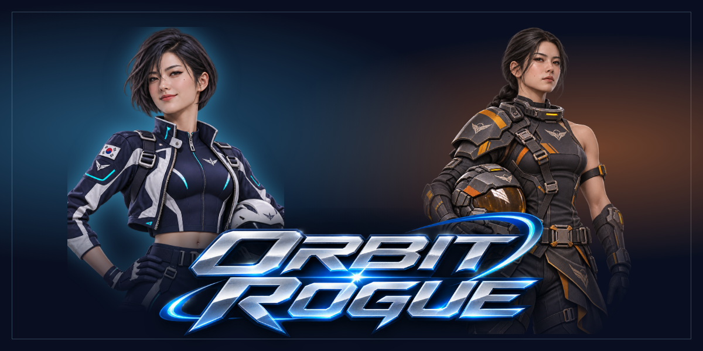

  

  우주전투 로그라이크

  <a href="https://rawcdn.githack.com/daning1212/orbit-rogue-space-combat-roguelike/255e2e1b4f701df6861f5215cc99c260507bc589/index.html"><strong>게임 시작 · v0.2.42</strong></a>

## 게임 소개

스피드형과 파워형 기체 중 하나를 골라 적과 운석을 돌파하고, 레벨업과 보급 상점에서 무기·기체·보조 장비를 강화합니다.

## 조작법

- 좌우 방향키: 기체 회전
- 위 방향키: 가속
- 아래 방향키: 제동
- Shift: 대시
- ESC: 일시정지 및 옵션
- 모바일: 가상 조이스틱과 가속·대시 버튼

## 주요 기능

- 스피드형 / 파워형 기체 선택
- 연속 유도 레이저와 여섯 종류의 기본 무기
- 기체 관성과 역추진 제동
- 레벨업 강화와 보급 상점
- 한국어 / English 선택
- 새로 출격할 때마다 전투 BGM 37곡 중 한 곡을 무작위로 선택합니다. 기본 재생 방식은 랜덤이며, 순서대로 또는 한 곡 반복으로 변경할 수 있습니다.
- 격납고에서는 펼쳐진 곡 목록에서 오프닝과 전투곡을 미리 들을 수 있습니다. 전투 중에는 하단 바에 곡명이 흐르고, 양쪽 화살표로 이전이나 다음 곡을 고를 수 있습니다.
- 플레이어의 음악 음량 바와 ESC 일시정지 메뉴의 음악 볼륨은 같은 설정을 사용합니다. 효과음 볼륨은 옵션에서 조절할 수 있습니다.

## 실행

별도의 설치 없이 `index.html`을 브라우저에서 열면 실행됩니다.

## 작업 이어가기 · v0.2.42

- 현재 공개 버전은 **v0.2.42**입니다. 게임 로직과 화면은 이 저장소의 `index.html`에 있습니다. [공개 버전 소스](https://github.com/daning1212/orbit-rogue-space-combat-roguelike/tree/255e2e1b4f701df6861f5215cc99c260507bc589)
- 모바일 보급 상점은 상품을 가로 두 열로 배치합니다. 코인과 내구도·실드 요약은 상품 위에 있고, 요약을 누르면 상세 능력치가 펼쳐집니다. **다음 구역으로** 버튼은 상품을 스크롤해도 하단에 보입니다.
- 홈페이지는 별도 `daning1212/healingarty` 저장소입니다. 모바일 ORBIT ROGUE 카드의 PLAY·링크 복사·다운로드를 설명 아래로 옮겨 설명이 한 단어씩 끊기던 문제를 해결했습니다. 카드의 PLAY와 ZIP은 v0.2.42 커밋을 가리킵니다. [홈페이지 소스](https://github.com/daning1212/healingarty) · [공개 게임 섹션](https://daning1212.github.io/healingarty/#games)
- 갤럭시 S23 울트라에서 찍은 v0.2.41 화면을 기준으로 수정했습니다. v0.2.42는 Chromium 모바일 에뮬레이션의 세로 폭 360·393·412px에서 카드 배치, 상세 능력치 펼치기, 상품 구매, 다음 구역 이동을 검증했습니다. S23 울트라 실기에서의 v0.2.42 확인이 남아 있습니다.
